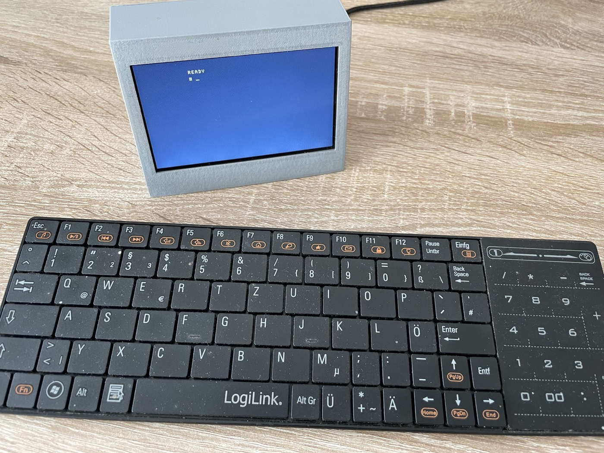

# Z1013 Tang Display

[Deutsch](#deutsch) · [English](#english)



## Deutsch

Dies ist meine eigenständige Display-Version des Z1013 für das Tang Nano 20K: ohne Fernseher und HDMI-Bild, dafür mit dem 4,3-Zoll-Sipeed-RGB-LCD (480 × 272), USB-Tastatur, FAT32-SD-Karte, Onboard-Audio und einem 3D-gedruckten Gehäuse.

**Stand 25.10.2026:** Der Z1013 startet auf echter Hardware und zeigt das Monitorbild auf dem Sipeed-LCD. Foto und Video dokumentieren den aufgebauten Stand mit USB-Tastatur und 3D-gedrucktem Gehäuse. Die 33-MHz-Bitstreams wurden mit Gowin erzeugt; die Timingberichte melden 0 Setup- und 0 Hold-Verletzungen. Simulationen für Z1013-Start, LCD-Speicher und Audio sind bestanden. Hörtests der verschiedenen Lautstärkefassungen bleiben gesondert gekennzeichnet.

## Foto, Video und Gehäuse

- [Foto des aufgebauten Z1013](stl/z1013-tang-display.jpg)
- [Kurzes Video des laufenden Systems](stl/IMG_0427.MOV) – etwa 40 MB
- [Gehäuseteil 1](stl/Z1013_1.stl)
- [Gehäuseteil 2](stl/Z1013_2.stl)
- [Hinweise zu Foto, Video und 3D-Druck](stl/README.md)

Die STL-Dateien bilden das auf dem Foto gezeigte Gehäuse. Drucker, Material und gewünschte Passung können andere Slicer-Einstellungen oder kleine Anpassungen erfordern.

## Grundlage

Übernommen aus dem lokalen Projekt `Z1013-Tang-Nano-20K`, Commit `08415827046f0e9f30750f22627d7db962088153`, einschließlich des F3-/USB-/FAT32-Stands. CPU-Kern, Boot-ROM und Zeichensatz sind unverändert. Taktabhängige CPU-Freigaben, Tastaturmakros, SD-Startwartezeit und Audio-Zeitgeber sind für 33 MHz angepasst. Bild- und Farbspeicher verwenden explizite Gowin-DPB-Blöcke; siehe `docs/RAM_FIX.md`. F3 lädt `DOS.COM`; es ist keine separate FPGA-Menüfunktion. Der Ausgangsstand bleibt im bisherigen Projekt erhalten. `docs/BASELINE_SHA256SUMS` dokumentiert die Quelldateien des Ausgangsstands, einschließlich später ersetzter HDMI-Dateien; dies ist kein Prüfsummenverzeichnis des neuen Projekts.

## Gowin öffnen und bauen

1. **`z1013_display.gprj`** öffnen.
2. FPGA: **GW2AR-LV18QN88C8/I7**, Device C. Top-Modul: **`z1013_display_top`**.
3. Verilog-Standard **SystemVerilog 2017**, VHDL **1993**, Security Bit **aus**. Die Konfiguration liegt unter `impl/z1013_display_process_config.json`.
4. Synthese und Place & Route ausführen. Alternativ `build.tcl` mit Gowins Tcl-Konsole ausführen.
5. Timingbericht prüfen. Erwartete Datei nach erfolgreichem Build: `impl/pnr/z1013_display.fs`.
6. Neue eigene Builds zunächst über **SRAM Program** testen. Die veröffentlichte Hardware ist auf Foto und Video im Betrieb dokumentiert.

Falls Gowin auf macOS zusätzliche Laufzeitpfade benötigt, den Platzhalter an die eigene Installation anpassen:

```sh
GOWIN_IDE="/Pfad/zu/Gowin_EDA/IDE"
DYLD_LIBRARY_PATH="$GOWIN_IDE/lib" DYLD_FRAMEWORK_PATH="$GOWIN_IDE/lib" "$GOWIN_IDE/bin/gw_sh" build.tcl
```

Die veröffentlichten Bitstreams wurden mit einer funktionsfähigen Gowin-Installation gebaut. Eine lokale Kommandozeileninstallation kann unabhängig davon eine passende Gowin-Lizenz benötigen.

## Display und Ton

- Foto: Displayaufkleber `043026-N6 (ML)`, Flexkabel-Aufdruck `043056B0-40-N`, 40-polig, ohne Touch.
- Grundlage für Anschlüsse und Timing ist Sipeeds 480×272-Beispiel. Eine gesonderte Bestätigung dieser Panelrevision durch ein Datenblatt steht aus.
- LCD: 9 MHz, 520 × 300 Gesamtraster, rund 57,69 Hz, negative HS/VS-Signale.
- Z1013: 256 × 256 Pixel ohne Skalierung, mittig bei x=112/y=8. Alle 32 × 32 Zeichen und Vollgrafik bleiben sichtbar.
- RGB565 über den vorhandenen LCD-Anschluss. Der ausgegebene Pixeltakt ist invertiert, damit das Panel die Daten eine halbe Periode nach deren Ausgabe übernehmen kann.
- CPU, Tastatur, SD und Klangerzeuger laufen mit 33 MHz Systemtakt. Die Z80-Taktfreigaben ergeben weiterhin 1/2/4/8,25 MHz; Tastaturmakros und Audioraten sind entsprechend angepasst. Video- und Farbspeicher verwenden ihren unabhängigen LCD-Leseport; Modusbits sind synchronisiert.
- Der MAX98357A erhält 48-kHz-I²S, zwei 32-Bit-Slots mit identischen 16-Bit-Monodaten. TED-Klang, PCM und Kassettenausgabe werden aus dem bisherigen Projekt übernommen.
- Lautsprecher zwischen den beiden Kontakten von **J4**, nicht zwischen einem Kontakt und Masse. Dies ist ein verstärkter Lautsprecherausgang.
- **Die alten externen PS/2-Pins 41/42 werden jetzt für das LCD verwendet.** Der PS/2-Eingang ist intern stillgelegt.
- HDMI-Ausgabe ist in diesem Projekt durch LCD ersetzt; die Anschlüsse teilen sich Bildsignale.

## SD-Karte und USB

`sdcard/` enthält eine vorbereitete Dateistruktur. Deren **Inhalt** in das Wurzelverzeichnis einer bereits passenden FAT32-Karte kopieren; eine bestehende funktionierende SD-Karte kann weiterverwendet werden. Es wurde keine SD-Karte verändert.

```text
DOS.COM
DOS/
  DOSKRNL.BIN
  HEX.OVL
  RST20.BIN
  VIEW.OVL
PACMAN.COM
KIKSTART.COM
PUNIVERS.COM
TERTRIS.COM
DEMO.COM
```

F1 zeigt das Verzeichnis, F2 lädt eine Datei, F3 lädt/startet DOS.COM. F9/F10/F11/F12 wählen 1/2/4/8,25 MHz CPU-Takt. Strg+Alt+Entf setzt das System zurück.

Die USB-Anbindung ist unverändert für die bisherige **v3923-Companion-Belegung** konfiguriert. Bei einem neuen Tang muss zuerst die aufgedruckte Boardrevision geprüft werden. Die bisherige v3923-Firmware liegt in `companion/`; sie wird nicht automatisch programmiert. Vorhandene 3921-Unterlagen und experimentelle Firmware sind unter `bl616/` als Referenz enthalten. Der Schaltplan 3921 allein bestätigt nicht die Revision des tatsächlich verwendeten Boards. Details: `docs/BASELINE_USB_KEYBOARD.md` und `bl616/README.md`; Pfade zu alten HDMI-Bitstreams in diesen Referenzunterlagen gehören zum Ausgangsprojekt.

## Prüfungen

`tests/run_checks.py` benötigt Python 3, GHDL und Icarus Verilog. `GHDL` kann auf eine portable ausführbare Datei zeigen; `GOWIN_PRIMITIVES` optional auf Gowins `prim_syn.v`.

```sh
python3 tests/run_checks.py
```

Prüfumfang und Grenzen stehen in `docs/VALIDATION.md`. Das echte simulierte Startbild steht in `docs/lcd_boot_simulation.png`.

## Autor und Projektseite

Ich bin Tobias Bremer und entwickle dieses Projekt. Weitere Z80-/Z180-Projekte und Dokumentation stehen auf [qlb-harz.de/Z80](https://qlb-harz.de/Z80/).

## Referenzen

- [Sipeed LCD-Beispiele](https://github.com/sipeed/TangNano-20K-example/tree/main/rgb_lcd/lcd_480_272), besonders `color_bar_1/src/lcd_ctrl.v`, `color_bar/src/tang_nano_20K_LCD.cst` und die 9-MHz-PLL.
- [Sipeed Originalschaltplan 3921 Rev. 1.30](https://dl.sipeed.com/fileList/TANG/Nano_20K/2_Schematic/Tang_Nano_20K_3921_Schematics.pdf), Blätter DISPLAY und AUDIO.
- Rechte und Herkunft der übernommenen Komponenten: `LICENSE.md` und `THIRD_PARTY.md`.

## Audiopins freigeben

Unter Project → Configuration → Place & Route → Dual-Purpose Pin muss **Use SSPI as regular IO** eingeschaltet sein. Die Audiopins 54/55/56 benötigen diese Freigabe. Die gespeicherte Prozesskonfiguration setzt `SSPI=true`; `build.tcl` setzt zusätzlich `set_option -use_sspi_as_gpio 1`. Eine bereits geöffnete Gowin-Instanz kann noch die alte Einstellung halten; deshalb dort den Haken ebenfalls prüfen.

## F4/F5-Lautstärke

Neue Fassung: `release/z1013_display_33mhz_volume_f4_f5.fs`. F4 leiser, F5 lauter, neun Stufen einschließlich stumm; Start mit 25 Prozent der bisherigen Signalamplitude. Gemeinsame Regelung für TED, PCM und Kassettenausgabe. Gebaut und ohne Setup-/Hold-Verletzungen geprüft; Übertragung und Hörtest stehen noch aus. Die bereits installierte BL616-Firmware bleibt dafür passend. Anschluss und Prüfdetails: `docs/VOLUME_F4_F5.md`.

### Zusätzliche Lautstärkereserve

`release/z1013_display_33mhz_volume_plus10.fs` ergänzt über F5 eine zehnte Stufe mit etwa 10 Prozent mehr Signalamplitude. Startwert und bisherige Stufen bleiben erhalten. Simulation und Gowin-Timing (0 Setup/Hold-Verletzungen) bestanden; Übertragung und Hörtest stehen noch aus.

---

## English

This is my standalone Z1013 display version for the Sipeed Tang Nano 20K. It replaces HDMI video and a television with the 4.3-inch Sipeed RGB LCD (480 × 272) and combines the FPGA board, display, USB keyboard support, FAT32 SD-card access, onboard audio, and a 3D-printed enclosure.

As of 25 October 2026, the Z1013 boots on real hardware and displays the monitor screen on the LCD. The photo and video document the assembled system. The supplied 33 MHz bitstreams were generated with Gowin; their timing reports contain no setup or hold violations. Separate listening tests for the different volume builds remain identified as pending.

### Media and enclosure

- [Photo of the assembled Z1013](stl/z1013-tang-display.jpg)
- [Short video of the running system](stl/IMG_0427.MOV) – approximately 40 MB
- [Enclosure part 1](stl/Z1013_1.stl)
- [Enclosure part 2](stl/Z1013_2.stl)
- [Media and 3D-printing notes](stl/README.md)

### Main features

- T80-compatible Z80 CPU with selectable 1/2/4/8.25 MHz speed
- 64 KiB RAM and the extended Z1013 boot ROM
- 256 × 256 Z1013 image centered on a 480 × 272 RGB LCD
- USB keyboard through the Tang Nano 20K v3923 BL616 companion
- FAT32 SD-card directory, load, save, and delete functions
- I²S audio through the onboard MAX98357A speaker output
- ready-made SD-card directory with games, DEMO.COM, and TBDOS
- F1 directory, F2 load, F3 start DOS.COM, F4/F5 volume, and F9–F12 CPU speed

Open `z1013_display.gprj` in Gowin EDA and use `z1013_display_top` as the top module. Ready-made FPGA images and their status are documented in [release/README.md](release/README.md). Copy the **contents** of `sdcard/` to the root of an existing FAT32 card. Details about validation, the BL616 companion, third-party components, and rights are available under `docs/`, `bl616/`, and [THIRD_PARTY.md](THIRD_PARTY.md).

I am Tobias Bremer, the developer of this project. More Z80/Z180 projects and documentation are available at [qlb-harz.de/Z80](https://qlb-harz.de/Z80/).
